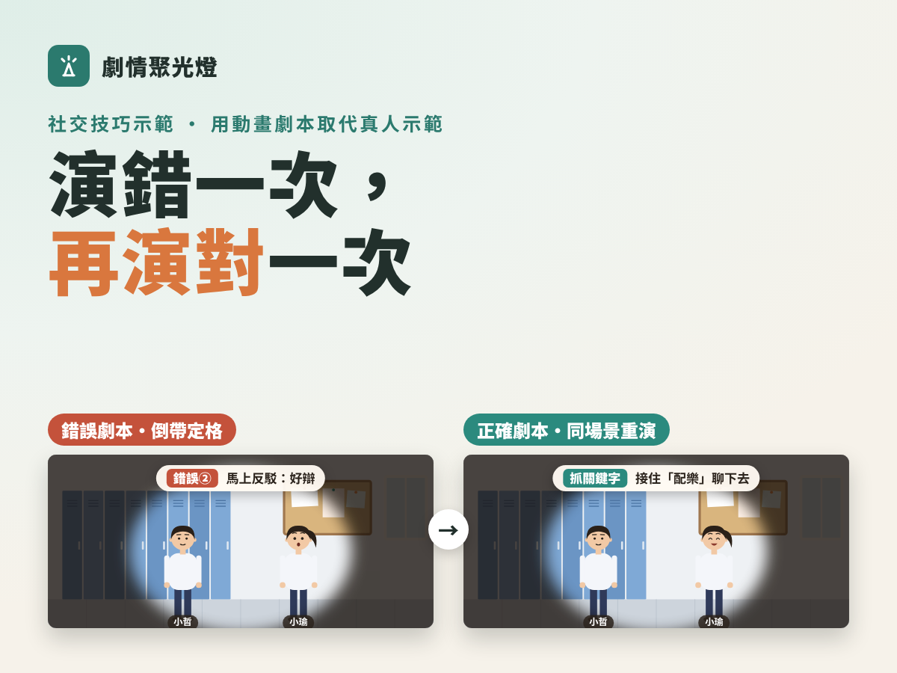

# 劇情聚光燈：用動畫劇本取代真人示範



社交技巧課最難的是**示範**：老師一人分飾兩角很尷尬，找學生上台又怕被笑、被模仿。
劇情聚光燈把示範做成**可以一步步播的動畫劇本**：同一個場景演兩次，先演錯的、再演對的。

這套做法出自資源班社交技巧課程《交朋友的 15 堂課》（參考 PEERS 架構改寫），15 課、每課每節都有一組劇本，實際上課使用中。

👉 **先看示範**：下載後打開 [`demo/index.html`](demo/index.html)，點畫面或按「下一步」就會播。

---

## 一、上課流程：錯 → 倒帶 → 教 → 對

| 順序 | 做什麼 | 畫面 | 學生做什麼 |
|---|---|---|---|
| ① 錯誤劇本 | **完整播一次，不打斷** | 主角連續踩 3–4 個地雷，對方最後找理由走開 | 在學習單寫下「哪裡怪怪的」 |
| ② 倒帶 | 同一段重來，**逐一定格** | 每個錯誤跳出**紅色標籤**：「錯誤①：做了什麼：違反哪一條」 | 對答案，看自己抓到幾個 |
| 換位思考 | 問三個問題 | — | 一兩句就好 |
| ③ 教策略 | 老師教這節的技巧（規則、步驟） | 一般簡報 | 聽、練習 |
| ④ 正確劇本 | **同一個場景、同樣的人**重演 | 每做對一步跳出**綠色標籤**（規則或步驟名稱） | 說出「這是哪一個技巧」 |
| 換位思考 | 再問一次同樣三題 | — | 和錯誤劇本比一比 |

**換位思考三問**（每段劇本看完都問，不深談情緒）：

1. ＿＿（對方）覺得怎麼樣？
2. 他覺得＿＿（主角）是個怎樣的人？
3. 他還想再跟＿＿聊天嗎？

### 為什麼這樣排

- **錯的先看**：學生先找錯，比老師直接講規則更投入；自己找到的錯誤記得比較牢。
- **第一次不打斷**：讓學生看到「整段對話是怎麼慢慢垮掉的」，對方的表情一路變化（開心 → 驚訝 → 煩 → 累 → 走開）。
- **同場景重演**：只差在主角的做法，差別一眼就看得出來，不用老師解釋。
- **不用真人上台**：焦慮高、怕被笑的學生也能安心看；錯誤是「角色」犯的，不是同學犯的。

---

## 二、寫劇本的原則

- **情境**：台灣國高中生的日常：教室、走廊、福利社、社團、LINE 群組、補習班。不要用美式情境。
- **一個錯誤一個標籤**，每段 3–4 個錯誤。錯誤要對到這節要教的規則，倒帶時標籤寫「做了什麼：違反哪一條」。
- **正確劇本**：同一個場景、同樣的人，每做對一步標一次，標籤用課堂上教的規則或步驟名稱（學生才對得起來）。
- **字幕一行內**（約 28 字）。兩個人輪流說話時，先 `clear` 再換人說，泡泡才不會疊在一起。
- **表情跟著劇情走**：對方的表情是學生判斷「哪裡怪怪的」最重要的線索。
- **敏感單元**：約會只用對話和表情，不畫身體接觸；霸凌台詞用溫和版本，欺負人的角色固定用一個名字，不要用主角群。

### 搭配學習單與教師手冊

- 學習單在該節放兩格：「錯誤劇本找錯表」（錯誤／違反哪一條）和「正確劇本對照」。
- 教師手冊附**劇本文字版**（`scriptText()` 會依步數列出字幕、台詞和標籤），沒有投影也能讓學生照著演。

---

## 三、檔案

```
engine/scene.js     畫面元件：角色、場景背景、聚光燈、對話泡泡、字幕、播放控制
engine/stage.js     角色外觀（制服／便服）和站位、泡泡位置、聚光燈的小工具
examples/hallway.js 範例劇本（第 2 課「維持交談」兩組）
build.js            產生示範頁 demo/index.html
demo/index.html     示範頁（單一檔案，可離線打開）
reference/drama.js  原課程網站怎麼把劇本自動接進網頁、簡報、教學流程（參考用）
docs/cover.js       產生封面圖 docs/cover.png
```

只需要 Node.js，沒有其他套件：

```bash
node build.js        # 產生 demo/index.html
```

---

## 四、劇本格式

一個場景＝背景＋角色＋一串步驟（beats）。每按一次「下一步」前進一步。

```js
const { LOOK, stage } = require('../engine/stage');

// 角色：[名字, 外觀, x 座標, 泡泡方向 'l' | 'r' | 'up']
const A = stage({ zhe: ['小哲', LOOK.zhe, 560, 'l'], yu: ['小瑜', LOOK.yu, 1040, 'r'] });
const both = A.spot('zhe', 'yu');   // 聚光燈照兩個人

const talkNG = {
  set: 'hallway', cast: A.cast,
  beats: [
    { cap: '下課，小哲在走廊遇到同班的小瑜。' },
    { spot: both, say: A.say('zhe', '你有看那部推理影集嗎？') },
    { say: A.say('yu', '有。') },
    { clear: true, expr: { yu: 'surprised' }, say: A.say('zhe', '拜託，大家都知道第三季才是神作。') },
    // ……
    // 倒帶：從這一步開始逐一定格
    { clear: true, spot: 'all', cap: '倒帶！剛剛哪裡出問題？' },
    { spot: both, say: A.say('zhe', '你有看那部推理影集嗎？'), ng: '錯誤①', cap: '只問「有沒有」：封閉式問句' },
  ],
};
```

### 每一步可以寫的欄位

| 欄位 | 意思 | 例子 |
|---|---|---|
| `cap` | 上方字幕 | `cap: '小瑜找理由走開了。'` |
| `ng` / `ok` | 字幕前面加紅色／綠色標籤 | `ng: '錯誤②'`、`ok: '開放式問句'` |
| `say` / `says` | 對話泡泡（一個／多個） | `say: A.say('zhe', '……')` |
| `think` | 內心話（虛線泡泡） | `think: A.think('ting', '他好近……')` |
| `clear` | 先清掉前一步的泡泡 | `clear: true` |
| `spot` | 聚光燈照誰；`'all'` 全亮 | `spot: A.spot('zhe')` |
| `expr` | 換表情 | `expr: { yu: 'annoyed' }` |
| `pos` | 角色走到新位置（有動畫） | `pos: { yu: [1420, 690] }` |
| `show` | 哪些人在場（其他人淡出） | `show: ['zhe']` |
| `time` | 右上角時間 | `time: '12:30'` |

- **表情**：`neutral` `happy` `excited` `angry` `worried` `tense` `tired` `annoyed` `calm` `surprised` `crying`
- **場景**：`classroom` 教室、`hallway` 走廊、`shop` 福利社、`club` 社團教室、`home` 客廳、`phones` 兩個房間（傳訊息）、`park` 公園、`cafe` 咖啡廳、`room`、`drinks`、`counter`
- **髮型**：`short` `side` `bob` `pony` `bun` `cap`；可加 `glasses: true`
- **道具**（`prop`）：`cup` `phone` `phoneUp` `phoneEar` `bookbag` `bag` `laptop` `papers` `charmbag` 等
- 畫布是 1600 × 720，角色站在 `y = 690`，左右兩人常用 `x = 560` 和 `x = 1040`。

### 放進自己的網頁或簡報

```js
const { renderScene, SCENE_CSS, SCENE_JS } = require('./engine/scene');
renderScene(talkNG, [0, 11], 'web');   // 第 0–11 步，附「上一步／下一步」按鈕
renderScene(talkNG, [12, 17], 'web');  // 倒帶段
renderScene(talkNG, [14, 14], 'print');// 印刷版：直接畫出某一步的樣子
```

把產生的 HTML 放進頁面，`<style>` 放 `SCENE_CSS`，頁尾 `<script>` 放 `SCENE_JS` 就能播。
簡報用 `'slide'` 模式，由翻頁的逐步出現帶動（做法見 `reference/drama.js`）。

---

## 五、讓 Claude 幫你寫劇本

把這個資料夾給 Claude（或放進 Claude Code 的 skills），照 [`SKILL.md`](SKILL.md) 的格式，告訴它：

> 這節要教「＿＿＿」，規則有：①…②…③…。學生是高一資源班，情境在＿＿＿。請寫一組錯誤劇本和正確劇本。

---

## 來源與授權

- 課程參考 Elizabeth A. Laugeson《PEERS® 青少年社交技巧訓練》（簡意玲 譯）與歐思賢老師的教學分享改寫，**並非官方教材**。
- 聚光燈畫面元件改寫自職場 SEL 課程的同名元件。
- 作者：小林老師（引路人）。採用 [CC BY-NC-SA 4.0](https://creativecommons.org/licenses/by-nc-sa/4.0/deed.zh-hant)：可以分享、改作，請標示出處、非商業使用、以相同方式分享。
